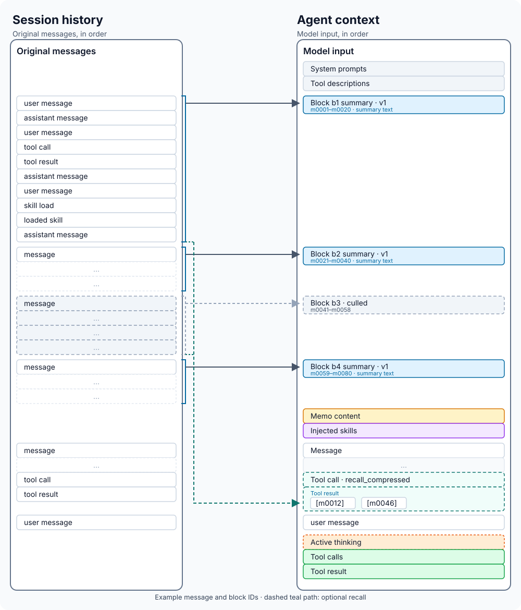
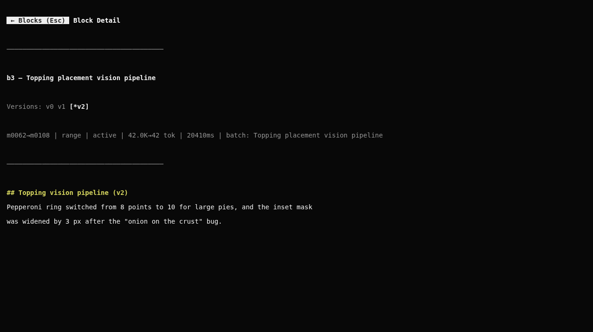
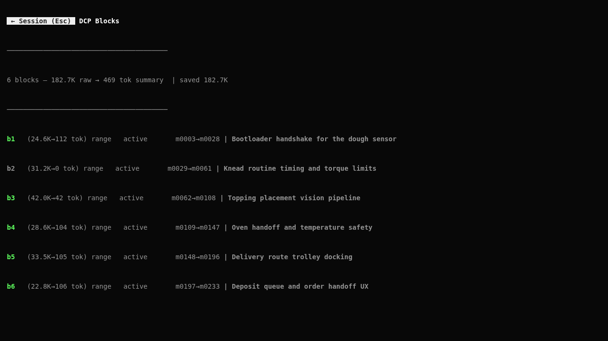

# OpenCode-HyperDCP

**Keep a long coding session useful without treating its history as disposable.**

OpenCode-HyperDCP is a context-management plugin for [OpenCode](https://opencode.ai).
It replaces selected conversation ranges in the agent's context with summaries
you can inspect, edit, and version. The agent can search the original messages
when a summary is no longer enough.

A summary should not be a point of no return. HyperDCP makes each compressed
range a visible **block**, with its own topic, message boundaries, summary
versions, and token counts. You can see what is representing the conversation
and change it as the work develops.

## Find your next answer

| Route                                  | Start here                                                                                                                                                                                                                                                        |
| -------------------------------------- | ----------------------------------------------------------------------------------------------------------------------------------------------------------------------------------------------------------------------------------------------------------------- |
| **Explanation — understand the model** | [What compression changes](#what-compression-changes) · [A summary you can revisit](#a-summary-you-can-revisit) · [Who initiates compression](#who-initiates-compression)                                                                                         |
| **Tutorial — learn by doing**          | [Make and inspect your first block](#make-and-inspect-your-first-block)                                                                                                                                                                                           |
| **How-to — finish a task**             | [Install the plugin](#install) · [Correct a summary](docs/context-tasks.md#correct-a-summary) · [Restore original messages](docs/context-tasks.md#restore-the-original-messages) · [Require a manual trigger](docs/context-tasks.md#require-a-manual-trigger)     |
| **Reference — look up details**        | [Commands and TUI controls](docs/context-reference.md#commands-and-tui-controls) · [Agent tools](docs/context-reference.md#agent-tools) · [Configuration](docs/context-reference.md#configuration) · [Skill lifecycle](docs/context-reference.md#skill-lifecycle) |

## What compression changes

An agent's **context window** is the material available to it for a particular
response. A long session can fill that window with completed investigations,
tool output, and decisions mixed with the work still in progress.

HyperDCP lets the agent summarize a completed range and use that summary in
place of the range in subsequent context. The block records which messages it
covers. Compression changes what the agent receives; it does not require you to
accept the summary as the only remaining account of the work.

For example, a finished debugging investigation might become a block containing
the cause, the chosen fix, and the evidence behind it. If the exact error output
matters later, the agent can use `recall_compressed` to search that range and
retrieve the original messages from the session history.



`recall_compressed` retrieves selected originals as tool results when needed;
it does not require restoring the whole range to context.

The distinction matters: a summary preserves an interpretation of the work;
recall recovers the detail needed to check it. Neither a smaller token count nor
the existence of a summary proves that every important fact was retained.

## A summary you can revisit

Open **DCP Blocks** to inspect the compressed ranges. Each entry shows its topic,
boundaries, compression mode, status, and token cost. Opening a
block shows the summary and its version tabs. The `*` marks the version used in
context; selecting another tab only changes what you are viewing.



In this demo, `*v2` is active. The message boundaries above the summary show
which part of the conversation the block represents.

If a summary misses a constraint, you can edit it in your text editor or ask the agent
to rewrite it. Both paths can create another active version while preserving
earlier versions for comparison and switching back. If the topic continues,
the agent can expand the existing block and revise its summary rather than
scatter the same topic across unrelated blocks.

There are two different ways to stop using a summary:

- **Cull it:** select summary version `0`. The covered messages stay out of
  context, and the summary is omitted too. Use this when neither needs to
  occupy the working context.
- **Decompress it:** restore the original messages to context. Use this when
  the agent needs the source material rather than a summary.

[Changing versions, culling, and restoring messages](docs/context-tasks.md#choose-a-summary-version)
are separate operations. Culling does not delete the block's saved summary
versions.

### Memory for how you work

The **memo** is a separate, per-session document that survives compaction.
Keep working commands, user constraints, and procedural knowledge there so they
do not depend on the wording of a particular topic summary. You and the agent
can edit it; the TUI renders it as Markdown.

See [Keep working instructions in the memo](docs/context-tasks.md#keep-working-instructions-in-the-memo)
for the memo view and editing instructions.

Skills have their own lifecycle. **DCP Skills** shows which skills are loaded
in the current session and which are being injected as protected context.
Loading takes effect immediately; the protected set is updated when a
housekeeping pass commits. See the [skill lifecycle reference](docs/context-reference.md#skill-lifecycle)
for the distinction and its effect on unloading.

## Who initiates compression

The agent writes the summaries and calls the compression tools. HyperDCP
supplies guidance and nudges as context grows; a nudge is not itself a
compression operation.

**By default, the agent can request compression without a manual trigger,**
subject to OpenCode permissions. To require an explicit trigger, use
`/dcp manual on`, then `/dcp compress` when you want a maintenance pass.
[Manual mode](docs/context-tasks.md#require-a-manual-trigger) can also be set in
configuration.

Autotoggle is a separate control. `/dcp autotoggle on` allows the agent to
switch an existing block's summary version, including version `0`. It is not a
prerequisite for creating a block, and you do not need it to switch versions
yourself with `/dcp toggle`.

### One housekeeping pass, one publication

The agent's context-maintenance edits are transactional. `enter_housekeeping`
returns eligible ranges and guidance. Compression, memo edits, expansions, and
summary changes accumulate in a draft. The agent finishes the whole pass before
calling `leave_housekeeping` once to publish it.

The block and memo views show committed state rather than partially edited
drafts. Ordinary tools are blocked during housekeeping by default, so the agent
does not continue implementation halfway through maintaining its context.
Exact-name exceptions can be configured with
[`housekeeping.allowedTools`](docs/context-reference.md#configuration);
they do not override OpenCode permissions.

## Install

The npm package is `@architectural-composition/opencode-hyperdcp`. It includes
native adapters for OpenCode v1 and v2: the server plugin provides context
operations, while the TUI plugin provides the sidebar and inspection pages.

Merge the package into the `plugin` array in
`~/.config/opencode/opencode.json`, keeping your other settings and plugins:

```json
{
    "$schema": "https://opencode.ai/config.json",
    "plugin": ["@architectural-composition/opencode-hyperdcp"]
}
```

Register the TUI plugin in `~/.config/opencode/tui.json` as well:

```json
{
    "$schema": "https://opencode.ai/tui.json",
    "plugin": ["@architectural-composition/opencode-hyperdcp"]
}
```

Restart OpenCode. In an active session, open the command palette and look for
**DCP Blocks**, **DCP Messages**, **DCP Memo**, and **DCP Skills**. These pages
are the installation checkpoint for the TUI; `/dcp` provides the server command
entry point.

Plugin registration belongs in OpenCode's configuration. HyperDCP's own
settings belong in a separate [`dcp.jsonc` file](docs/context-reference.md#configuration).

## Make and inspect your first block

Use an [installed](#install) OpenCode session with a completed investigation or other
finished conversation worth summarizing. The default range mode rejects ranges
smaller than **2,000 tokens**, so a fresh greeting-only session is not enough.
Compression tools must also be permitted by your OpenCode settings.

1. Enter `/dcp manual on` to keep this exercise under manual control.
2. Request a compression pass:

    ```text
    /dcp compress Preserve the decisions, constraints, and evidence from the completed work; leave the current task uncompressed.
    ```

    The command invokes the agent. It receives instructions to enter
    housekeeping, select completed ranges, write summaries, and commit the
    maintenance pass. Wait for that pass to finish. If there is no eligible
    completed range of sufficient size, continue the session rather than
    compressing the current task just to produce a block.

3. Open **DCP Blocks** from the command palette (`/dcp-tui-blocks`). Find the
   block created by the pass. The list shows its topic, message boundaries, and
   source-to-summary token counts:

    

    This capture uses synthetic demo data; your blocks and counts will differ.
    Select your block and read its summary. Check a decision you remember
    against the text; note the block ID and the `*` active-version marker.

4. Press **e** to open the block's active summary in your text editor
   (`$VISUAL`, then `$EDITOR`, then `vi`). Preserve the
   file's delimiter lines, make a useful correction to the summary, then save
   and exit. The saved text becomes another active version.
5. Compare the earlier and edited versions using the tabs. The `*` stays on the
   active version even while you read another one. Press **Esc** to return.

You have made a compressed range inspectable and corrected what represents it
in context. To switch back, follow [Choose a summary version](docs/context-tasks.md#choose-a-summary-version).
To investigate a missing detail, [ask for the original messages](docs/context-tasks.md#recover-an-exact-detail).

Manual mode remains on after the exercise. Leave it on for explicit compression
triggers, or use `/dcp manual off` to allow agent-initiated compression again.

On OpenCode v1, manual block edits, memo edits, and summary-version toggles
trigger a user message. On v2, informational command output may be queued rather
than appearing immediately in the transcript. See [host behavior and known issues](docs/context-reference.md#host-behavior-and-known-issues).

## Project

HyperDCP is a fork of
[opencode-dynamic-context-pruning](https://github.com/Opencode-DCP/opencode-dynamic-context-pruning).
See the [changelog](CHANGELOG.md) for release details,
[known issues](KNOWN-ISSUES.md) for host-specific caveats, and
[contribution terms](CONTRIBUTING.md) before contributing.

Report reproducible problems in the [issue tracker](https://github.com/yuriha-chan/OpenCode-HyperDCP/issues).
The project is licensed under [AGPL-3.0-or-later](LICENSE).
