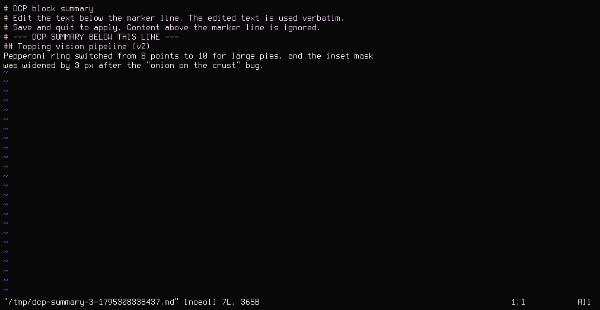
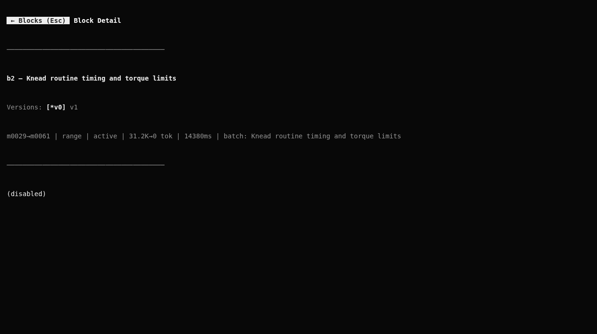
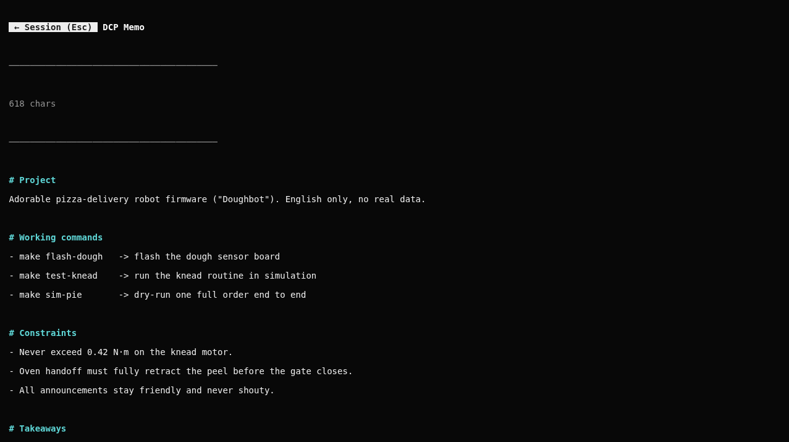

# Work with compressed context

These tasks assume HyperDCP is installed and an OpenCode session is active.
For a guided introduction, use [Make and inspect your first block](../README.new.md#make-and-inspect-your-first-block).
For the underlying model, see [What compression changes](../README.new.md#what-compression-changes).
The [command reference](context-reference.md#commands-and-tui-controls) is a direct lookup route.

## Correct a summary

To make a versioned correction yourself:

1. Open **DCP Blocks** (`/dcp-tui-blocks`) from the command palette and select the
   block.
2. Press **e** or select **Edit**. This opens the active summary in your text editor,
   even if you were viewing another version's tab.
3. Keep the temporary file's delimiter lines intact. Edit only the summary
   document, then save and exit successfully.
4. Reopen or inspect the block. The correction is a saved summary version,
   selected as active; the earlier versions remain available.

The editable document excludes the `[Compressed conversation section]` wrapper
and trailing block-reference tag. HyperDCP supplies those in model context.



The demo editor shows the boundary marker above the summary. Change the
document below it, not the generated header.

To have the agent rewrite a summary instead, enter `/dcp rewrite <block> <instruction>`.
For example, if the block is `b3`:

```text
/dcp rewrite b3 Preserve the rejected approaches and the reasons they were rejected.
```

This invokes the agent to produce and save a summary version. Wait for its
housekeeping pass to commit, then inspect the result. Use the actual block ID
from your session, not the example ID.

For a short direct replacement, `/dcp edit <block> <text>` edits the base
summary; `-a` appends to it. That command does **not** create a saved rewrite
version. Use the editor or agent rewrite when you want version history.

## Choose a summary version

The block detail tabs are for viewing. To change the version the agent receives,
use `/dcp toggle <block>` to list saved versions, then provide a version number:

```text
/dcp toggle b3
/dcp toggle b3 1
```

Here `b3` is an example block; `1` selects its original summary. Use an existing
version number from the listing. The active version is marked with `*` in block
detail. Your `/dcp toggle` command does not require autotoggle.

To let the **agent** switch versions, use `/dcp autotoggle on`. Its
`toggle_summary_version` tool still runs inside housekeeping and is subject to
OpenCode permissions. Use `/dcp autotoggle off` to revoke that session control.

## Cull a block without restoring its messages

Use version `0` when the range should contribute neither its source messages
nor its summary to context:

```text
/dcp toggle b3 0
```

Check the block detail: the active summary is disabled. To restore a summary,
select an existing nonzero version with `/dcp toggle`. Culling preserves saved
versions; it is not decompression.



Here the demo block's `*v0` marker and `(disabled)` body confirm that its
summary is omitted; the compression itself is still active.

## Restore the original messages

Use `/dcp decompress` to list the available compression targets, then restore
one by its displayed ID:

```text
/dcp decompress b3
```

This stops that compression from replacing its original messages. If the block
is inside another active compression, restore the enclosing compression first,
as directed by the command response.

To apply a user-decompressed compression again:

```text
/dcp recompress b3
```

Recompression requires the compression's origin message to remain in the
session. This is different from switching a culled block back to a nonzero
summary version. See the [state reference](context-reference.md#blocks-and-summary-versions)
if you are deciding between these operations.

## Recover an exact detail

Ask the agent to search the original messages behind a block, then retrieve the
matching messages with `recall_compressed`. For example:

> Search the original messages in block b3 for the failing command, retrieve
> the matching message, and check its exact flags before using it again.

Substitute your own block and question. Search can be scoped to a block; raw
retrieval uses the message IDs returned by the search. To inspect saved
summaries instead, the agent uses `fetch_summary_versions`.

Recall reads session history. Treat it as a way to recover detail behind a
summary, not as a separate backup of the conversation.

## Require a manual trigger

For the current session:

```text
/dcp manual on
```

The agent's compression calls are then blocked until you trigger the flow with
`/dcp compress [focus]`. The optional focus tells the agent what to preserve or
prioritize; it is not an exact message-range selector.

To start sessions in manual mode, merge this into your
[`dcp.jsonc`](context-reference.md#configuration) and restart OpenCode:

```json
{
    "manualMode": {
        "enabled": true
    }
}
```

Use `/dcp manual off` to allow agent-initiated compression in the current
session. This switch is separate from autotoggle and does not replace host
permissions.

## Protect a message or tool output

Run `/dcp messages` to see recent message references, or open **DCP Messages**
(`/dcp-tui-messages`) to browse the tracked chain. Choose the message you need
to protect, then use its ID:

```text
/dcp protect m0005
```

Use your session's ID. `/dcp protect` lists manually protected messages;
`/dcp unprotect m0005` removes that protection.

To retain specified tool outputs during compression, merge a compression
protection setting into `dcp.jsonc` and restart:

```json
{
    "compress": {
        "protectedTools": ["read"],
        "protectSubagent": "metadata"
    }
}
```

The example protects `read` outputs. Subagents use their own
[`protectSubagent` setting](context-reference.md#subagent-protection), not the
generic tool list. Protection from `/dcp sweep` has a separate
`commands.protectedTools` setting.

## Keep working instructions in the memo

Open **DCP Memo** (`/dcp-tui-memo`) and press **e** to edit the per-session memo
in your text editor. Save and exit, then inspect the page to confirm the text.



The demo memo keeps working commands and constraints together, separately from
the topic summaries. Use it for instructions that should carry across topics.

For agent-maintained memory, ask the agent to update the memo during its next
housekeeping pass. Commands, procedural constraints, and tool preferences can
live there independently of a topic's summary. The agent's `edit_memo` tool
supports nested topics and individual text items; see [Agent tools](context-reference.md#agent-tools).

## Allow a tool during housekeeping

Ordinary tools are blocked while housekeeping is active. If your workflow needs
a particular tool during that pass, add its exact registered name to
`housekeeping.allowedTools` in `dcp.jsonc` and restart:

```json
{
    "housekeeping": {
        "allowedTools": ["read"]
    }
}
```

This allows `read`; it does not grant all read-like tools access, and it does
not override an OpenCode permission denial.

Return to the [README's documentation map](../README.new.md#find-your-next-answer)
or look up [host-specific behavior](context-reference.md#host-behavior-and-known-issues).
